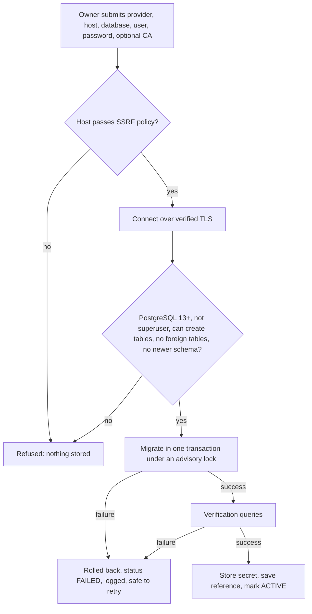

# Phase 2: Customer-Owned Database Infrastructure

## Setup workflow

Replacing a working connection keeps the old one until the new one verifies. A failed replacement leaves the showroom running.

## API (`/api/v1/platform/tenants/current/database`, Owner only)

| Path | Purpose |
| --- | --- |
| `POST /test` | Validate only; stores and changes nothing |
| `POST /connect` | Connect or replace, then provision and verify |
| `POST /migrate` | Apply pending migrations, or retry after a failure |
| `POST /health` | Check TLS and schema; records the result |
| `POST /rotate-credentials` | Verify new credentials, store them, retire the old secret |
| `POST /revoke` | Drop connections and delete the secret; the showroom's data stays in its own database |

The database setup screen is at `/showroom/database`.

## Migrations

- **Source:** the existing `alembic/` chain defines every showroom schema, so there is one definition. Single-showroom mode uses the same chain.
- **History:** `alembic_version` in each showroom database, and `tenant_migration_runs` centrally (versions, status, error code, exception class name only).
- **Safe retry:** PostgreSQL DDL is transactional, so a failure leaves nothing behind.
- **Different versions:** each database upgrades from wherever it is, one step at a time.
- **Non-destructive:** a test fails if any `upgrade()` drops a table or column. Destructive changes need a documented plan and explicit approval.
- **Pending for upgrades:** running migrations across all showrooms on a release is manual per showroom today (the Owner's Run migrations button). Fleet rollout is not built.

## Connection management

- One engine per showroom, cached and shared. Each has a pool of 2 plus overflow 2, with pre-ping and 300-second recycle.
- At most 50 engines per process (least recently used evicted) and 100 concurrent tenant sessions (503 beyond that). All configurable.
- Engines expire after 15 minutes, which re-resolves DNS through the SSRF policy.
- A background job every 5 minutes closes the connections of showrooms idle for 10 minutes.
- Sessions are created per request and never reused, so one tenant's session cannot serve another.
- The numbers are per worker process: multiply by worker count when sizing, and agree limits with showrooms using small database plans.

## Acceptance criteria

Evidence: `tests_saas/test_phase2_tenant_databases.py`, run against two real TLS PostgreSQL 16 servers, plus a browser run of the setup screen.

| # | Criterion | Status |
| --- | --- | --- |
| 1 | Two showrooms connect two different databases | Demonstrated |
| 2 | Each database independently owned | Demonstrated by design and separate servers. Real cloud-hosted providers not yet tried |
| 3 | Requests route to the right database | Demonstrated, confirmed directly on each server |
| 4 | Tenant A cannot reach Tenant B's database | Demonstrated |
| 5 | Credentials never reach the frontend | Demonstrated in API responses and browser storage |
| 6 | Credentials use a secure secrets manager | **Partial.** The abstraction and an encrypted development store work. A real manager is not connected, and production refuses to start without one |
| 7 | Connections use TLS | Demonstrated with `pg_stat_ssl`; non-TLS, untrusted and wrong-host servers refused |
| 8 | Pooling avoids exhaustion | Demonstrated with 40 concurrent requests and engine eviction. Not load-tested at scale |
| 9 | Schema initialization works | Demonstrated |
| 10 | Migrations versioned and repeatable | Demonstrated, including failure, retry and incremental upgrade |
| 11 | Existing business functions use the abstraction | Demonstrated for customers, quotations, leads, follow-ups, test rides, inventory, dashboards and export. Not every endpoint was exercised individually |
| 12 | No customer or quotation data centrally | Demonstrated. See the logging limits in `TENANT_SECURITY.md` |
| 13 | Failure gives a clear error with no leak | Demonstrated |
| 14 | Automated cross-tenant tests | Demonstrated |
| 15 | Revoking affects only that tenant | Demonstrated |
