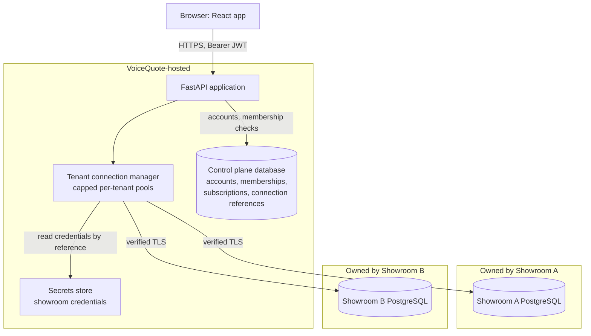
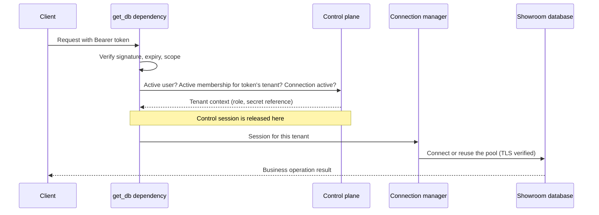

# VoiceQuote SaaS Architecture

One application serves many motorcycle showrooms. VoiceQuote runs the application and a central **control plane**. Each showroom owns a separate PostgreSQL database holding all of its business data.

`MULTI_TENANT_ENABLED` switches this on. When it is off (the default) the application behaves as a single-showroom deployment and none of the platform routes exist.

## Request flow

Existing services and repositories were not rewritten. `get_db`, used by about 65 endpoints, returns the showroom's session in multi-tenant mode, and `get_current_user` returns the staff row from that database.

## Code layout

| Path | Purpose |
| --- | --- |
| `app/control_plane/` | Central models, schemas, onboarding service and routes, database routes |
| `alembic_control/` | Migrations for the central database only |
| `app/core/tenant_context.py` | Tenant resolution and authorization dependencies |
| `app/database/control_plane.py` | Control-plane sessions |
| `app/database/secrets.py` | `SecretStore` abstraction and the development store |
| `app/database/tenant_connection.py` | SSRF policy, TLS context, safe error mapping |
| `app/database/connection_manager.py` | Capped per-tenant engine cache |
| `app/database/tenant_router.py` | Request to tenant session |
| `app/database/provisioning.py` | Compatibility checks, migrations, verification |
| `app/services/tenant_staff.py` | Keeps the showroom's staff row in step with the central account |
| `alembic/` | Schema of every showroom database (and of single-showroom mode) |

The control-plane metadata (`ControlPlaneBase`) is separate from the business metadata (`Base`), so business tables cannot be created in the central database by accident. A test asserts the exact set of central tables.

## Schema naming

The existing names were kept so existing code keeps working:

| Brief | Implemented as |
| --- | --- |
| `customers.name` | `customers.full_name` |
| `quotations.salesperson_id` | `quotations.sales_executive_id` |
| `quotations.quotation_date` | `quotations.created_at` |
| `quotations.validity_date` | `quotations.expires_at` |
| `vehicles` | `vehicle_brands` → `vehicle_models` → `vehicle_variants` |
| `quotation_items.vehicle_id` etc. | Added as typed columns on comparison option rows |

A single-vehicle quotation has no `VEHICLE_OPTION` row: its figures are on the parent, as before. A comparison has exactly two such rows and one quotation number.

## Known constraints

- Gmail and WhatsApp settings are still global, so all showrooms would share one sending account until a later phase makes them per Owner.
- AI features use one global Gemini key and can send lead details to Google when it is set. Review this before enabling it for customers' data.
- Header notifications still call the old Supabase client, and the forgot-password pages depend on Supabase Auth, which holds none of these users. Password reset does not work in multi-tenant mode yet.
